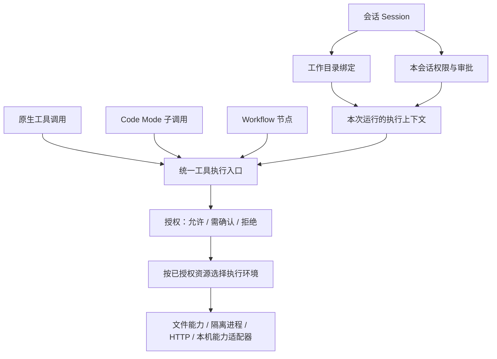

# 会话、工作区、权限与执行环境重设计

> 日期：2026-10-22。状态：设计提案，尚未实施，不替代当前运行契约。
> 决策入口：[ADR 1367](adr/1367-session-scoped-execution-policy-design.md)。实施状态只在[架构重构路线图](architecture-refactor-roadmap.md)维护。

## 1. 建议采用的模型

以**会话**作为用户工作的容器，将相关概念收敛到四个职责明确的领域：

| 领域 | 回答的问题 | 拥有的内容 | 不拥有的内容 |
|---|---|---|---|
| 工作区 Workspace | 这段会话主要在哪里工作？ | 可选工作目录、相对路径基准、目录绑定版本 | 审批规则、远程服务权限、OS 隔离 |
| 权限 Policy | 这项具体操作是否允许，是否需要确认？ | 资源范围、能力授权、审批规则、拒绝规则 | 目录导航、进程启动实现、工具编排 |
| 执行环境 Execution Environment | 如何实际落实已经确定的边界？ | 文件句柄能力、进程隔离、网络执行限制、取消和资源预算 | 用户意图、永久授权、模型工具发现 |
| 工具调用 Tool Invocation | 模型如何发现和组合能力？ | 原生调用、按需发现、Code Mode、静态 Workflow | 新权限、独立安全模式、持久任务生命周期 |

四者由会话执行上下文组合。不能画成 `Workspace → Permission → Sandbox → CodeMode` 的包含关系：Code Mode 和原生调用是并列入口，权限与隔离是每条副作用路径共同经过的边界。



Haven 是 Windows 助手，工作区允许为空。打开应用、控制窗口、操作远程服务不要求先创建代码项目；这些能力仍分别授权。初期不新增 Project/Workspace 数据库实体、可继承的自定义 profile 系统或通用 RuntimeManager。

## 2. 当前混乱的具体来源

以下按实际代码核对，历史 ADR 仅用于解释演变：

| 现状证据 | 职责交叠或理解成本 | 目标 |
|---|---|---|
| `common::types::PermissionMode` 同时包含 `Plan`、`Default`、`AutoEdit`、`Autonomous` | Plan 是操作限制，其他值主要改变确认行为 | 将“只分析”的任务约束与审批策略分开 |
| `SecurityConfig` 同时保存 `execution_root`、`sandbox_mode`、`network_policy` 和授权列表 | 工作位置、资源范围、审批和加密设置共处一层 | 全局只存默认值和硬限制，会话保存自己的工作绑定 |
| `AuthorizationEngine::SafetyConfig` 拥有单个活动 `ExecutionWorkspace` | 标题区切目录会更新全局 `security.execution_root`；新 attempt 使用新根 | 切换 A 会话的目录不改变 B 会话或已创建后台任务 |
| `SandboxMode` 实际主要控制本地写入，`NetworkPolicy` 又包含 `Ask` | “只读”不是整个任务无副作用；网络边界夹带审批语义 | 资源限制描述可访问对象；询问只由审批规则决定 |
| `McpToolExposure` 包含 direct / model_only / deferred / codemode / hidden | 可发现性、是否禁用和调用通道混在一个枚举 | 能力可用性、目录展示和调用适配分别表达 |
| `path_sandbox_block` 从动态参数收集路径；ADR 1334 已修复 URL 被当成本地写入的问题 | 参数字段名不足以说明资源类型 | 工具契约返回 typed 本地路径、网络目的地或远程对象 |

已有的统一授权 owner、proof、目标绑定、执行前重检、DirectoryCapability、进程撤销及 durable nested journal 都有保留价值。需要改变的是它们的组合与所有权，不是重新建立一套安全系统。

审阅时工作树已有 MXC `sandboxed_process.rs`、Shell 接入及相关未提交修改。它们作为进行中的实现考虑，不作为已合并、已验收的能力。本提案不修改或代提交这些代码。ADR 1163 和个别模块注释仍有“嵌套确认不能续接”的早期描述；当前实现与 [ADR 1321](adr/1321-resumable-nested-workflow-executions.md) 已具备子调用确认和 durable checkpoint，重设计保留这一能力。

## 3. 对照主流实现后的取舍

以下为 2026-10-22 查阅的官方资料；借鉴点与 Haven 的设计选择分别列出。

| 实现 | 官方资料中的结构 | 对 Haven 的启发 |
|---|---|---|
| Codex | sandbox 定义技术边界，approval policy 决定何时询问；`never` 可与不同 sandbox 组合 | 不把“不弹窗”等同于完全放行；隔离能力由 executor 落实。[Sandbox](https://learn.chatgpt.com/docs/sandboxing)、[Approvals](https://learn.chatgpt.com/docs/agent-approvals-security) |
| Codex permission profiles | 新 profile 统一描述文件与网络权限，仍属 beta，并明确不与旧 sandbox 配置叠加 | 可以给用户提供简单预设，但避免新旧配置双真源，也暂不引入 profile 继承。[Permissions](https://learn.chatgpt.com/docs/permissions) |
| Claude Code | 工具权限与 shell 的 OS sandbox 分工；其 sandbox 文档明确说明文件工具、MCP 和 hooks 不在 shell sandbox 内，原生 Windows shell 当前不受该 sandbox 隔离 | 必须按执行路径说明实际保护，不能给整个应用贴一个“已沙箱化”标签。[Permissions](https://code.claude.com/docs/en/permissions)、[Sandboxing](https://code.claude.com/docs/en/sandboxing) |
| Gemini CLI | policy engine 对工具调用产生 allow / deny / ask_user，sandbox 由单独执行机制实现；文档注明 workspace policy tier 当前禁用 | 借鉴统一决策输出，不照搬优先级数字或尚未生效的项目策略层。[Policy engine](https://geminicli.com/docs/reference/policy-engine/)、[Sandbox](https://geminicli.com/docs/cli/sandbox/) |
| Pi | Code Mode 在无 Node、文件和网络 API 的 QuickJS 环境中组合工具调用 | Code Mode 放在编排层；脚本之外的文件、网络和系统权限仍属于被调用能力。[Code Mode](https://pi.dev/docs/latest/codemode) |

Windows 的实现应独立验证。Codex 当前官方文档将 MXC 列为兼容设备上的推荐实现；这不能证明 Haven 的 MXC 适配已具备相同能力。Haven 应保留自己的 backend probe 和 Windows 端到端验收，详见 [Windows sandbox](https://learn.chatgpt.com/docs/windows/windows-sandbox)。

## 4. 会话拥有工作绑定，Tools 拥有可执行能力

### 4.1 持久绑定与运行时句柄分开

会话保存以下逻辑信息，字段名是目标契约草图，不是已实现 API：

```rust
struct SessionExecutionBinding {
    working_root: Option<PathBuf>,
    task_intent: TaskIntent,         // Analyze | Act
    approval_policy: ApprovalPolicy, // AskWhenNeeded | DenyIfRequired
    resource_policy: SessionResourcePolicy,
    context_revision: u64,           // 会话绑定版本，不是实体 ID
}
```

- `SessionActor` 经现有 `SessionStore` 持久事件更新绑定；`session_events` 是恢复权威，不能增加另一套 snapshot 恢复路径。Session 的展示字段如需物化，只是投影。
- Tools 校验并打开目录，内部保存 DirectoryCapability、执行策略和不透明运行句柄。Agent 只持有有名的窄 port / handle 和只读 DTO，不获取底层文件句柄、registry 或 manager。
- 每个 run 捕获一份上下文，所有原生调用、嵌套子调用和 prompt 使用同一工作绑定。执行前再叠加最新拒绝、撤权和硬边界，冻结上下文不冻结旧权限。
- ConfigService 仍是全局配置权威；AuthorizationEngine 是授权决策权威。若保留编译后的策略缓存，必须记录来源 revision，由其 owner 原子失效/替换，不再允许消费者维护可独立修改的配置副本。

### 4.2 工作目录的生命周期

1. 全局“默认工作目录”只用于新会话的初始值，不再是所有会话共享的活动目录。普通新会话不从 Haven 安装目录或开发仓库自动获得项目权限。
2. 当前会话显式切目录，经后端验证后提交新的绑定。活跃 run 中的切换排队到安全暂停/轮次边界，UI 显示待生效目录，不把旧 run 的半段操作重定向到新根。
3. A/B 两段会话可分别绑定两个目录；切换页面、移除 MRU 快捷项和关闭会话视图都不改变绑定或授权。
4. 无目录时，相对 Files 路径明确失败；绝对文件路径按具体资源授权。确需运行命令时，使用后端管理的私有 attempt scratch，或显式且已获准的 cwd；scratch 不是用户项目写权限，也不能隐式扩大可写范围。
5. 重启后从 durable 绑定恢复路径意图，再重新校验路径和打开能力；路径不可用时标记 unavailable，不回退到另一目录。未记录绑定的旧会话保持未绑定，不能套用“此刻全局选中的目录”。
6. 初期 MRU 继续是最多 20 项的前端便利列表，不承担身份、安全或恢复职责。目录身份需要后端处理 Windows 大小写、reparse、UNC 和目录替换，前端字符串去重不提供安全保证。

ToolRun 在创建时保存自己的工作绑定；Schedule 定义保存触发工作所需的绑定，每次 occurrence 重新解析当前有效权限。二者不读取执行时标题区选中的目录。新建子会话最多继承父上下文允许的范围，不能因继承获得更宽能力。

## 5. 一个 Policy，明确区分资源限制、操作授权和审批

### 5.1 资源限制描述“能接触什么”

- **文件**：分别描述 readable / writable roots 与禁止访问的路径。工作目录只是构造默认 roots 的输入；写入许可不自动授予凭据、应用配置、数据库或安全策略文件的修改能力。运行依赖只读目录、私有 scratch、用户附件和生成资产各有明确来源与生命周期。
- **网络**：只描述禁用、允许的目的地集合或无额外目的地限制；移除其中的 `Ask`。公网请求仍做 SSRF、DNS pin、跳转和大小校验，私网例外须显式配置。工具出网规则不控制模型 provider 的已配置连接；后者仍由 LLM/config owner 管理。
- **本机能力和远程对象**：窗口、剪贴板、注册表、电源、远程账户/对象按其资源类型授权。它们不会因工作区可写而自动开放，也不把 URL 当成本地路径。

一个操作可以同时读源文件、写目标文件、上传网络并启动进程，契约必须表达完整的资源集合。保留 `OperationPolicy` 作为入口，在其 owner 内补充规范化的资源声明；不再以 `target`、`path` 等 JSON 字段名推断安全含义。MCP 的 read-only 等 annotations 只作提示，不能替代可信适配器证据。

不透明能力必须明确保留“无法检查”的部分：不能编造远端对象级限制、不能凭 tool 名称认定只读，也不能在 Analyze 中执行未知副作用。只有确实能落实的范围才能出现在权限摘要中。

### 5.2 操作授权描述“同意做哪件事”

目标 grant 至少绑定 capability、资源范围、适用约束和生命周期。例如，“本会话可修改所选目录的普通文件”不等于永久允许所有 `files.*`；“访问某 MCP server 的某账户”不等于准许该进程访问本机全部目录。

`Once / Session / Always` 保留为生命周期；`Operation / Group / Tool` 只是匹配粒度，不能取代目标范围。永久 allow 必须有明确范围；已有永久 deny 保持保守约束。精确执行 proof 继续绑定 session、规范输入、已解析资源、目标身份、策略 revision、上下文 revision 和期限，且不能跨调用复用。

Shell 命令如果只能作为不透明脚本文本处理，就不能从一个命令前缀推导任意后续脚本的授权。只有能可靠表达目标的命令约束才支持可复用 allow；否则绑定完整命令、cwd 和执行上下文，或每次确认。

### 5.3 审批只回答“允许的动作是否还要问”

审批策略收敛为：

| 策略 | 行为 |
|---|---|
| `AskWhenNeeded` | 已被具体授权且满足风险规则的操作直接执行，其余可审批操作进入确认 |
| `DenyIfRequired` | 同样的已授权操作可以执行；仍需确认的操作返回 `approval_required`，不弹窗、不自动放行 |

安全只读和已授权的普通目录编辑可自动执行；敏感读取、外发、破坏性操作和不透明执行按真实策略决定。隔离并不让工作区内删除或数据外发自动变成低风险。Critical/强制确认保留独立下限，永久 allow 和无人值守都不能绕过。

“只分析”是任务约束 `Analyze`，在所有 allow 之前拒绝用户可见的修改和外部副作用；内部日志、事件提交等系统记账按既有 owner 运作。它不再伪装成一种审批偏好，也不同于“本地文件只读”。

### 5.4 边界扩展和批准当前动作分开

已有范围内的确认只批准该项操作。确需写入另一个目录或访问新增域名时，用 typed 的边界扩展请求显示具体资源、动作和有效期；获准后为该次操作/会话产生受限扩展，再重新授权和执行。全局硬禁止、显式 deny 和 Analyze 限制不可由普通确认覆盖。

因此“保存这个文件到另一个文件夹”不需要用户先切到 Full Access；“允许本次执行”也不能偷偷改写全局安全设置。若失败发生在副作用启动之后且结果未知，不能通过扩展权限自动重跑。

统一执行顺序为：解析可信 operation/资源/目标契约 → 检查禁用和显式 deny → 检查 Analyze、资源边界与执行环境是否能落实 → 应用强制确认下限及匹配有范围的授权 → 按审批策略确认或拒绝 → 取得精确 proof → 副作用前重检并执行。不为已知无法执行的隔离请求先弹确认，也不把一次批准当作对后续策略变化的豁免。

## 6. Sandbox 作为执行环境的能力

删除把 `SandboxMode` 同时当文件范围、进程能力和用户权限等级的用法。目标执行路径分三种，均由统一授权入口控制：

| 路径 | 落实方式 | 保证范围 |
|---|---|---|
| Haven 内建受控操作 | 文件目录句柄、typed network destination 等原生适配器 | 只保证适配器能证明并落实的资源范围 |
| 隔离子进程 | 平台 backend 将同一资源策略编译为真实文件、网络和子进程限制 | 只有 probe 和 spawn 成功才可报告相应隔离已生效 |
| 不隔离的本机执行 | 当前 Windows 用户身份 + 明确授权 + 进程树管理 | 不报告文件/网络隔离；不作为隔离失败后的自动降级 |

`SandboxedHostProcess` 这样的工具声明最多说明“支持某隔离适配路径”，不能证明本次进程已经受保护。Tools 在执行前取得平台能力报告，匹配本次请求并发放绑定策略的 spawn permit；Platform 负责最终实施。若 MXC 只支持网络全开/全关，就不能声称已落实域名白名单，必须拒绝不支持的请求，或使用另一个已验收且等强的后端。

Shell、Skill 的安装/执行、MCP stdio、LSP、hooks 和媒体 helper 均进入进程路径盘点；不能只改 Shell 的 enum 就认为所有进程受限。Job Object 的进程树、数量和取消能力继续保留，但不称作文件或网络隔离。

HTTP MCP 按远程 endpoint、账户和目标对象授权，不要求本机进程隔离；允许连接 endpoint 也不代表允许执行其中所有远程操作。stdio MCP 的**启动**与每次**工具调用**分开授权：第一阶段为不同执行上下文使用独立进程实例，禁止把 A 的较宽进程租给 B。未来只有 server/config/credential identity 和文件/网络边界完全兼容时才讨论复用。

撤权先阻止新 attempt，并取消仍由 Haven 管理的受影响进程树或请求；已提交的外部副作用不承诺回滚。收紧全局限制立即作用于各上下文；授权扩大只作用于明示的会话/动作。

## 7. Code Mode 回到工具编排层

保留 QuickJS evaluator、当前有界预算、子调用独立授权，以及 ADR 1321 的确认/恢复语义：

1. 原生调用、Code Mode 子调用、Workflow 节点共用同一 capability identity、资源契约和执行网关。
2. 拆开 `McpToolExposure`：**可用性**决定能否调用；**目录展示**决定直接提供还是按需发现；**调用适配能力**决定是否支持原生/脚本调用。默认按需发现，普通用户不逐 server 选择 Legacy / CodeMode。
3. `model_only` 之类例外必须由可解释的调用/交互约束表达；迁移不能让原本禁止嵌套的能力突然允许脚本调用。hidden 的禁用语义也不能退化成“仅从目录隐藏”。
4. Code Mode 可作为会话 runtime 内部的组合能力，逐步覆盖有 typed contract 的内建工具和 MCP；无可靠契约的工具保留原生调用。自动选择只发生在明确支持的调用通道内，不能为了成功改走更宽权限路径。
5. 需要确认时暂停于具体子调用；确认后从脚本入口驱动，由 durable journal 返回已完成结果。不得持久化 QuickJS heap；回放前缀分歧或 started-without-completed 均停止，不能重执行已发生或结果未知的 handler。
6. Code Mode 本身不成为可保存的定时脚本。后台实例属于 ToolRun，时间/触发属于 Schedule，可恢复编排继续使用有界静态 Workflow。

对 evaluator 的进程内隔离和对工具子进程的 OS 隔离分别报告。后续增加并行子调用必须单独证明确认顺序、journal identity、取消和部分副作用语义；本方案不借重构顺便打开并行。

## 8. UI 收敛为两项常用选择

聊天标题区只保留 **工作目录** 与 **执行方式**。预设是对下面策略的原子选择，不是另一份可变权限状态：

| 预设 | 任务约束 | 默认资源范围 | 审批行为 |
|---|---|---|---|
| 只分析 | Analyze | 已绑定目录/明确授权资源的读取 | 敏感读取等必要确认仍询问，修改直接拒绝 |
| 协作执行（默认） | Act | 选定目录的普通编辑、私有 scratch 和明确授权的能力 | 范围内常规操作自动，其他需要时确认 |
| 无人值守 | Act | 与协作执行相同的范围和显式预授权 | 需要追加确认时停止并记录原因 |

无工作目录时显示“未选择目录”，仍可使用已授权的桌面与远程能力。系统控制不通过“选一个更大目录”开启；需要时在操作确认中说明窗口、应用或系统资源。

设置重新归为三处：

- **会话默认值**：新会话目录、默认执行方式；更改不重绑旧会话。
- **权限与授权记录**：本会话的文件范围、网络目的地、系统/远程能力、allow/deny 的对象和有效期。技术细节折叠在这里；单项改动后预设显示“自定义”，不再叠加一套互相覆盖的模式。
- **工具与集成**：启用/停用、连接、凭据、发现；Code Mode 预算和调用例外属于高级设置。

实际隔离状态作为当前执行的只读诊断展示，例如“命令进程：MXC 隔离”或“本机进程：当前用户权限”；不增加一个由用户勾选就宣称生效的“sandbox 开关”。错误区分 `capability_disabled`、`resource_denied`、`approval_required`、`isolation_unavailable`、`stale_context` 和 `outcome_unknown`，并显示能解决当前问题的具体操作。

## 9. 分片落地与删除范围

每个切片保持可验证、可回退，不通过先重命名全部类型制造大 diff；只推进一条 Active 垂直链。

| 顺序 | 完整切片 | 随切片删除的旧设计 | 验收重点 |
|---|---|---|---|
| 1 | Session 创建/恢复 → 工作绑定 → Files/Shell/prompt 使用同一 run context | 全局活动 workspace 对会话的隐式影响 | 双会话、恢复、失效目录、切目录期间的 attempt 与后台任务 |
| 2 | typed 资源契约 → 单一授权 → 文件/HTTP 执行 | 参数名猜路径；network 中的 Ask；Plan 与审批偏好的混合 | 源/目标、URL、目的地、敏感数据、deny 优先与 proof 重检 |
| 3 | 将已有 MXC 工作接入统一执行环境，并盘点其他进程路径 | 将静态隔离声明视作已实施证明；隔离失败后的宽权限回退 | 文件越界、子进程逃逸、网络不支持、取消、撤权与真实 Windows |
| 4 | 拆解 MCP exposure → 原生/Code Mode 共用资源契约与 journal | server 级 Legacy/CodeMode 常规选择及重复授权分支 | hidden/model_only 不放宽、子确认、恢复不重复副作用 |
| 5 | 标题区两项选择、权限明细和具体边界扩展 | 旧 permission/sandbox/network 三组模式及重复目录入口 | 预设原子应用、自定义状态、拒绝原因、无目录的桌面场景 |

切片 1 先承载当前策略语义，不提前改变风险阈值；切片 2 才切换新审批/资源模型。已有 MXC 实现可先独立完成其原范围，后续按切片 3 接入本方案，不要求丢弃现有工作或等待整轮重构。

本轮只提交设计文档，无数据库、配置、IPC 或运行行为变化，**无需重置任何数据**。未来实施的契约处理必须逐片记录：

- 会话绑定和新增事件按仓库 schema/事件规则版本化；若变更 schema，遵守现有“不做运行时迁移”的数据库完整备份/重置流程，不能在本提案中承诺升级保留历史。
- 替换安全配置时只转换能保守映射的值；无法确定资源范围的旧 allow 必须失效并要求重新授权，旧 deny 保守保留。`full_access` 不能直接变成永久的无范围本机授权，`autonomous` 不能映射成自动批准所有操作。
- MCP 的 hidden / model_only / codemode 约束必须等强转换；无法转换则将受影响能力停用并提示复核，不能静默扩大调用通道。删除旧 enum 的同一切片删除全部读写入口与旧测试。
- 实施切片需同步 architecture、IPC inventory、UI 规范和 release/reset；历史 ADR 保留，并在真正被实施方案替代时链接新 ADR。本提案不提前改写当前架构或发布版本说明。

## 10. 验收矩阵与停止条件

| 场景 | 必须成立 |
|---|---|
| A 会话绑定项目 A，B 绑定项目 B | 切换 A 不改变 B 的相对路径、授权或默认 cwd |
| 无目录会话打开应用/查询远程服务 | 可按具体能力授权；不要求创建代码项目 |
| 工作区内普通编辑与工作区内破坏性命令 | 分别按契约和风险判断，不能仅因“在沙箱内”全部自动允许 |
| 写入另一个目录 | 只对具体资源请求扩展，不切换全局 Full Access |
| Analyze + 旧 Always allow | 修改、远程副作用和系统控制仍拒绝 |
| 无人值守 + 需确认 | 明确停止；后台任务不能无限等待无人可回答的弹窗 |
| read source / write destination / upload 同时存在 | 所有资源分别通过策略；URL 不被解释成本地文件 |
| MXC 不可用或不支持域名级网络限制 | 拒绝该进程请求，不降级到 host 或开放网络；无关 Files/HTTP 能力仍可用 |
| MCP stdio 跨会话 | 不复用比调用会话更宽的进程边界；transport 连接不继承工具授权 |
| Code Mode 第三步需要确认/崩溃 | 不重执行前两步；未完成节点为结果未知；复用原调用 identity |
| ToolRun/Schedule 创建后标题区切目录 | 使用创建时绑定和当前有效拒绝规则，不读取 UI 当前选择 |
| 确认期间参数、路径身份、目标或 revision 变化 | 原 proof/receipt 拒绝；重新计算并按需要再次确认 |
| 运行中撤权/取消/策略收紧 | 阻止后续 attempt；取消受影响受管执行；保留部分副作用和未知结果 |
| 重启且原目录丢失 | fail closed，不套用新默认目录，不从 messages 投影补造绑定 |

收益判断采用可复跑的行为场景、调用链和 owner 检查：用户只需常用的目录/执行方式选择；相同操作从不同调用通道得到相同授权；全局目录影响消失；旧配置与旧执行分支真正删除。若实现需要新增第二授权 owner、可任意取用的 manager、持久 JS 运行时或无界 profile 继承，就退回本方案复核，不继续堆抽象。

代码切片按 [development standards](development-standards.md) 的影响面门禁执行；涉及本方案的跨 crate、持久化、安全或 Rust↔UI 变化需完整 Rust/UI/契约检查，Windows 隔离另做真实系统负向验收。设计文档切片只验证格式、链接、ADR 索引与差异，不以未运行的代码测试宣称实现通过。
